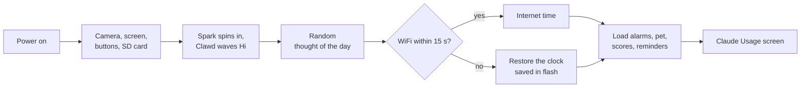
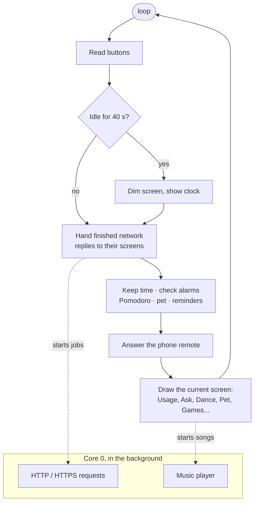
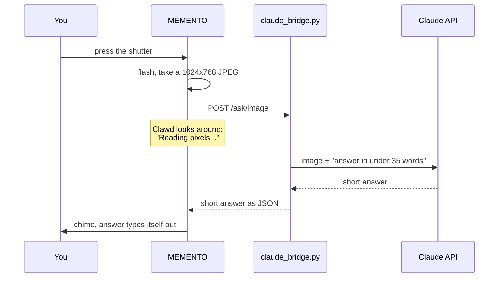

<div align="center">

# Clawd Handy

**A pocket Claude companion for the Adafruit MEMENTO camera board.**
It shows your Claude plan usage, answers questions about what the camera sees, dances, keeps your alarms, plays games, and gets hungry if you forget about it.

 &nbsp; 

</div>

> Fan-made, not affiliated with or endorsed by Anthropic. Claude is a trademark of Anthropic. The spark and the pixel bot on screen are drawn by this code.

<p align="center"></p>

## What it does

| | Feature | What you see |
|---|---|---|
| 📊 | **Claude Usage** | Your 5-hour session and weekly limits as animated bars, reset countdowns, a per-app breakdown, and a bot whose mood follows how close you are to the limit. Beeps at 80% and 100%. |
| 📷 | **Claude Ask** | Point the camera, press the shutter: Claude says what it sees, or solves the maths or logic problem in the photo, in under 35 words. |
| 🕺 | **Claude Dance** | Three chiptune songs played on the speaker, with four dance moves synced to the beat. |
| 🐣 | **Clawd Pet** | A Tamagotchi: feed, play, tickle, nap. Food, energy and fun drop over time, even while the board is off. |
| ⏰ | **Alarms** | Four alarms set with the buttons (once / daily / weekdays / weekends). They ring with a funk tune and a dancing Clawd. Shake or press any key to snooze. |
| 🙂 | **Face Finder** | Live camera with boxes around faces. Clawd follows the first face with its eyes and waves at newcomers. |
| 🌍 | **World Live** | Weather, planes overhead on a radar, the ISS on a world map, recent earthquakes, and crypto prices. Free services, no API keys. |
| 🎮 | **Games** | Flappy Clawd, Block Drop, 2048, and Tilt Catch (steered with the accelerometer). Best scores are saved. |
| 🧰 | **Toolbox** | Pomodoro timer, spirit level, 3-2-1 photo booth, timelapse with flipbook playback, QR scanner, smart-home buttons, and a phone remote. |
| 🌙 | **Idle clock** | After 40 s without a button press the screen dims to a clock with Clawd asleep in a nightcap, plus your next alarm and a usage peek. |
| 📱 | **Phone remote** | Open `http://clawd.local` to edit alarms, feed Clawd, start a dance or a focus timer, or test the alarm. |

Everything from the original sketch is still there: Telegram bot, motion-triggered security photos, the camera mode, and I2C commands to two helper Arduinos.

## How it works

<p align="center"></p>

The board does all the drawing, music, games and timekeeping itself. It only needs help for things a microcontroller can't do safely or quickly:

- **`claude_bridge.py`** runs on your PC. It reads your plan usage with your existing Claude Code login (the token never leaves the PC), sends photos to the Claude API, and finds faces and QR codes with OpenCV.
- The board finds the bridge by itself: if the saved address stops answering, it broadcasts on your WiFi and the bridge replies with its current IP.
- Weather, planes, the ISS, earthquakes and crypto prices come **directly** from free public APIs over HTTPS. No PC needed.

### Startup



### Every pass through `loop()`



Network requests and music run on the ESP32-S3's second core, so animations keep playing while Claude thinks and the beat stays steady while the screen redraws.

### Asking Claude about a photo



### Keeping time without WiFi

Once the board knows the time, it keeps counting on its own. The time is also saved to flash every 5 minutes, along with the alarms, pet stats, high scores and Telegram reminders. If it boots with no WiFi, it carries on from the saved time, shown with a `~` until internet time is back. Time spent switched off can't be counted.

## What you need

**Hardware**

- [Adafruit MEMENTO (PyCamera)](https://learn.adafruit.com/adafruit-memento-camera-board): ESP32-S3, camera, 240×240 screen, speaker, accelerometer, buttons
- A microSD card (the sketch expects one at boot; used for photos and timelapses)
- Optional: a LiPo battery, so it can sit on your desk unplugged

**Software for the board**

- Arduino IDE 2.x with the **esp32 by Espressif** boards package **3.3.x** (tested with 3.3.7)
- Board: **Tools → Board → esp32 → Adafruit pyCamera S3**, **PSRAM: enabled**
- Libraries (Library Manager): Adafruit PyCamera Library, Adafruit GFX, Adafruit ST7735 and ST7789, Adafruit AW9523, Adafruit NeoPixel, Adafruit BusIO, SdFat - Adafruit Fork, ArduinoJson 7, UniversalTelegramBot, NTPClient

**Software for the PC bridge**, needed for Usage, Ask, faces and QR

- Python 3.10+
- [Claude Code](https://claude.com/claude-code), logged in. The bridge reads plan usage with that login.
- For Claude Ask: an API key from [console.anthropic.com](https://console.anthropic.com). API use is billed separately from a Claude plan, roughly 1 cent per photo.

## Setup

1. **Get the code**
   ```bash
   git clone https://github.com/vikas-meu/Clawd_Handy.git
   cd Clawd_Handy
   ```
2. **Add your WiFi:** copy `claude_desk_buddy/secrets.example.h` to `claude_desk_buddy/secrets.h` and fill it in. `secrets.h` is git-ignored.
3. **Upload:** open `claude_desk_buddy/claude_desk_buddy.ino` in the Arduino IDE, pick the board and PSRAM settings above, and upload. Press reset if it doesn't restart on its own.
4. **Start the bridge on your PC:**
   ```bash
   python -m venv .venv
   .venv\Scripts\activate            # Windows (macOS/Linux: source .venv/bin/activate)
   pip install -r requirements.txt
   set ANTHROPIC_API_KEY=sk-ant-...  # only for Claude Ask (PowerShell: $env:ANTHROPIC_API_KEY="sk-ant-...")
   python claude_bridge.py
   ```
   It prints the address to use. The board finds it automatically after the first try, so editing `BRIDGE_URL` in the sketch is optional.
5. **Phone remote:** open **Toolbox → Phone Remote** and scan the QR code, or go to `http://clawd.local`.

## Controls

**SEL** always goes back to the menu. Any button wakes the idle clock.

| Screen | Buttons |
|---|---|
| Usage | **OK** refresh · **◀ ▶** session/weekly ↔ per-app page · **Shutter** say hi again |
| Ask | **Shutter/OK** photo · **▲▼** scroll the answer |
| Dance | **OK** pick a move · **◀ ▶** song · **▲▼** tempo |
| Pet | **OK** feed · **▶** play · **▲** tickle · **▼** nap / wake |
| Alarms | **▲▼** pick · **OK** edit · **▶** on/off. While editing: **◀ ▶** field, **▲▼** change (hold to scroll), **OK** save |
| Alarm ringing | **OK** stop · any other key or a **shake** snoozes 5 min |
| World Live | **◀ ▶** page · **OK** refresh |
| Games | Flappy: **OK** flap · Blocks: **◀ ▶** move, **▲** turn, **▼** faster, **Shutter** drop · 2048: D-pad · Tilt Catch: tilt the board |

## Settings worth knowing

| In the sketch | Default | What it changes |
|---|---|---|
| `IDLE_AFTER_MS` | `40000` | How long before the idle clock |
| `MY_LAT`, `MY_LON` | `0` (auto) | Pin your location for weather and planes instead of the IP-based guess |
| `TILT_FLIP_X`, `TILT_FLIP_Y` | `false` | Flip if Tilt Catch moves the wrong way |
| `SONGS[]` | 3 songs | Add your own: one drum bar plus bass and chord patterns over 4 chords |
| `QUOTES[]` | 36 lines | The boot "thought of the day" |

| In `claude_bridge.py` | Default | |
|---|---|---|
| `MODEL` | `claude-opus-5-5` | Model for Claude Ask |
| `EFFORT` | `low` | Keeps thinking, and token spend, small |

## Troubleshooting

- **"No bridge at …":** start `claude_bridge.py`, keep the PC and board on the same WiFi, and allow Python through the firewall. Some phone hotspots block devices from talking to each other.
- **Usage says "Login expired":** open Claude Code once on the PC so it refreshes its login.
- **Claude Ask says "Set ANTHROPIC_API_KEY":** set the key in the same terminal that runs the bridge.
- **Planes page says "Too many requests":** OpenSky allows about 400 anonymous requests a day. The page only refreshes while it's on screen.
- **Stuck on boot without an SD card:** the original sketch waits for an SD card. Insert one.
- **Building it yourself:** don't add the ESP32 `WebServer` library. It pulls in `FS.h`, which makes SdFat stop defining `File` and breaks the camera library's `takePhoto()`. The phone remote uses a tiny server built on `WiFiServer` instead.

## Project layout

```
claude_desk_buddy/
  claude_desk_buddy.ino   the whole board firmware
  secrets.example.h       copy to secrets.h (git-ignored) and add your WiFi
claude_bridge.py          PC helper: usage, Claude Ask, faces, QR, LAN discovery
requirements.txt          Python packages for the bridge
docs/
  make_images.py          redraws boot.gif, dance.gif and screens.png from the sketch's drawing code
  architecture.svg        the animated diagram above
```

## License

GPL-3.0, see [LICENSE](LICENSE). Copyright © 2026 Vikash Singh Thakur.
