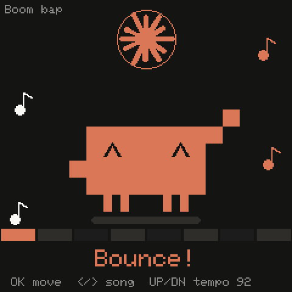
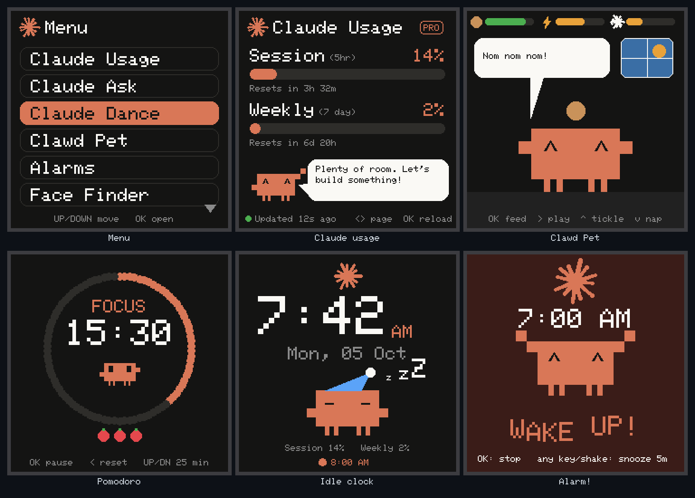
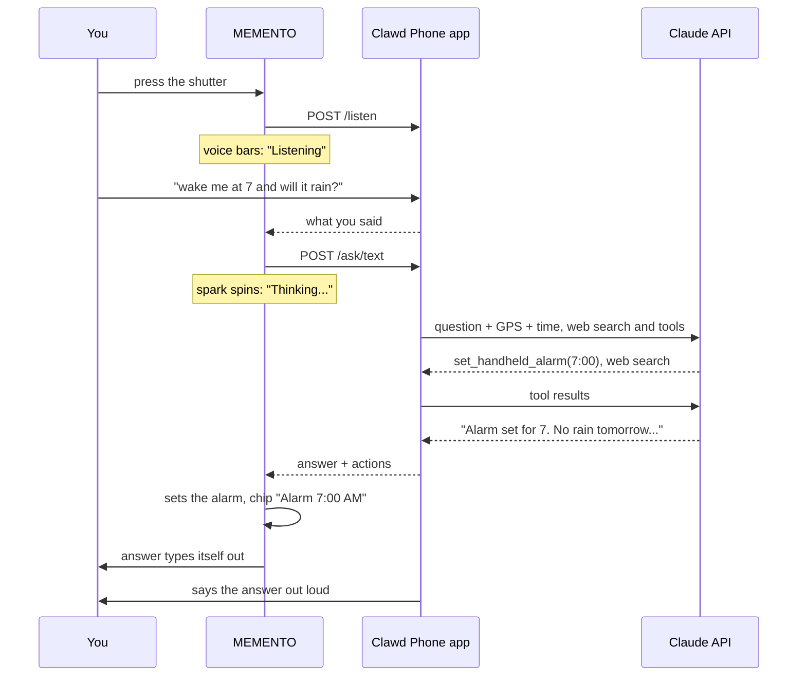
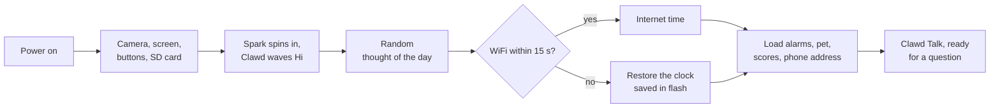
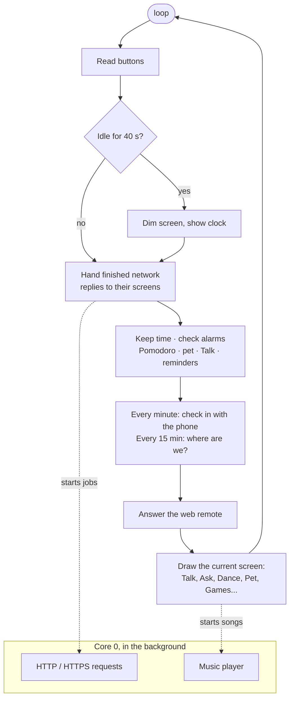

<div align="center">

# Clawd Handy

**A pocket AI companion for the Adafruit MEMENTO camera board, powered by your Android phone.**
Press the shutter and talk: it answers, searches the web, translates, sets your alarms and plays your music. It also reads what the camera sees, plays games, and gets hungry if you forget about it.

 &nbsp; 

</div>

> Fan-made, not affiliated with or endorsed by Anthropic. Claude is a trademark of Anthropic. The spark and the pixel bot on screen are drawn by this code.

<p align="center"></p>

## What's new in 2.1

- **Daily Feed**, a new menu: your **YouTube subscriber count** (with confetti when it goes up), crypto, exchange rates, Hacker News, on this day in history, a random Wikipedia article, a trivia quiz and a joke.
- **World Live** grows to 8 pages: **air quality**, **sun & moon** (sunrise arc, moon phase), **space weather** (aurora chances) and the **next rocket launches** with a live countdown.

## What's new in 2.0

- **Your phone replaces the PC.** The Python bridge is gone. The Clawd Phone Android app now does the listening, Claude calls, GPS, faces and QR codes, and the board works anywhere your phone goes, including on the phone's own hotspot.
- **Clawd Talk:** Rabbit R1-style push-to-talk with web search, actions on the board and the phone, translation and notes. It's the new start screen.
- **Translate lens** in Claude Ask for signs, menus and labels.
- **One-tap pairing** instead of copying a token by hand.
- **Weather follows you:** the location comes from phone GPS and refreshes every 15 minutes.
- **Settings live in the sketch**, and a git filter keeps the private ones out of commits.

## What it does

| | Feature | What you see |
|---|---|---|
| 🎙️ | **Clawd Talk** | Push-to-talk, like a Rabbit R1. Press the shutter and speak; your phone listens, Claude answers on the screen and the phone says it out loud. Three modes: **Ask** (with web search and actions, e.g. *"wake me at 7"*, *"focus for 25 minutes"*, *"remind me to call mum in an hour"*, *"play lo-fi on my phone"*, *"directions to the nearest pharmacy"*), **Translate** into 15 languages, and **Note**. |
| 📷 | **Claude Ask** | Point the camera, press the shutter. **Look** mode says what it sees or solves the maths or logic problem in the photo. **Translate** mode reads signs, menus and labels in your language. |
| 📊 | **API Status** | Claude requests and tokens used today, plus the phone link: battery, address, and where your location comes from. |
| 🕺 | **Claude Dance** | Three chiptune songs played on the speaker, with four dance moves synced to the beat. |
| 🐣 | **Clawd Pet** | A Tamagotchi: feed, play, tickle, nap. Food, energy and fun drop over time, even while the board is off. |
| ⏰ | **Alarms** | Four alarms, set with the buttons or by voice (once / daily / weekdays / weekends). They ring with a funk tune and a dancing Clawd. Shake or press any key to snooze. |
| 🙂 | **Face Finder** | Live camera with boxes around faces. Clawd follows the first face with its eyes and waves at newcomers. |
| 🌍 | **World Live** | Location and space, 8 pages: weather from your phone's GPS (it follows you around), air quality, sunrise/sunset and tonight's moon, planes overhead on a radar, the ISS on a world map, space weather and aurora chances, the next rocket launches with a countdown, and recent earthquakes. |
| 📰 | **Daily Feed** | 8 pages: your YouTube channel's subscribers, views and videos (confetti when they go up), crypto prices, exchange rates in your currency, the Hacker News front page, a slice of history from today's date, a random Wikipedia article, a trivia quiz that keeps score, and a joke with a punchline on OK. |
| 🎮 | **Games** | Flappy Clawd, Block Drop, 2048, and Tilt Catch (steered with the accelerometer). Best scores are saved. |
| 🧰 | **Toolbox** | Pomodoro timer, spirit level, 3-2-1 photo booth, timelapse with flipbook playback, QR scanner, smart-home buttons, and a web remote. |
| 🌙 | **Idle clock** | After 40 s without a button press the screen dims to a clock with Clawd asleep in a nightcap, plus your next alarm and the phone's battery. |

Everything from the original sketch is still there: Telegram bot, motion-triggered security photos, the camera mode, and I2C commands to two helper Arduinos.

### The Clawd Phone app

The Android app in [`android_companion/`](android_companion/) is the board's ears, eyes and hands. It replaces the old PC bridge, so no computer is needed.

- **Talk card**: the same Ask / Translate / Note modes as the handheld. Tap to talk or type, and answers are spoken out loud.
- **Handheld card**: whether the board is connected, its address, and one-tap pairing.
- **Where you are**: the live GPS fix the board uses, with a nearby map.
- **Journal**: everything you asked, from the handheld or the phone.
- **Notes & reminders**: written by you, or by Clawd when you ask.
- **Setup checklist**: API key, microphone, location, notifications, and permission to open apps from the handheld.

## How it works

<p align="center"></p>

The board does all the drawing, music, games and timekeeping itself. For everything a microcontroller can't do (it has no microphone, and shouldn't hold your API key), it asks the phone:

- **The Clawd Phone app** listens for push-to-talk, gets your GPS location, and calls the Claude API with web search and tools. It also finds faces and QR codes with ML Kit and counts today's API use. The Anthropic API key is encrypted with the Android Keystore and only sent to Anthropic.
- **The board finds the phone by itself**, on home WiFi or on the phone's own hotspot. It broadcasts on the network, and if nobody answers it tries the gateway (on a hotspot, that's the phone). It remembers the address for next time.
- **Pairing is one tap.** Tap **Pair handheld** in the app and, for the next two minutes, the board can fetch the pairing token and keep it in flash. Every request carries that token, so other devices on the network can't use the phone.
- **Actions run where they belong.** Claude's tools set alarms, start focus timers, dance and feed the pet on the board. Notes, reminders, music and maps happen on the phone. Say *"set an alarm for 7"* into the phone app and the board picks it up within a minute.
- **Weather, planes, the ISS, earthquakes and crypto** come directly from free public APIs over HTTPS. If the phone isn't around, the board guesses its location from your internet connection instead.

### Push-to-talk



Translations come back in two forms. The board's font only has ASCII, so Hindi, Japanese and other scripts show up romanized on the screen, while the phone speaks them in the real language.

### Startup



### Every pass through `loop()`



Network requests and music run on the ESP32-S3's second core, so animations keep playing while Claude thinks and the beat stays steady while the screen redraws.

### Keeping time without WiFi

Once the board knows the time, it keeps counting on its own. The time is also saved to flash every 5 minutes, along with the alarms, pet stats, high scores and Telegram reminders. If it boots with no WiFi, it carries on from the saved time, shown with a `~` until internet time is back. Time spent switched off can't be counted.

## What you need

**Hardware**

- [Adafruit MEMENTO (PyCamera)](https://learn.adafruit.com/adafruit-memento-camera-board): ESP32-S3, camera, 240×240 screen, speaker, accelerometer, buttons
- A microSD card (the sketch expects one at boot; used for photos and timelapses)
- An Android phone (8.0 or later), on the same WiFi as the board or sharing its own hotspot (set to 2.4 GHz)
- Optional: a LiPo battery, so it can go in your pocket

**Software for the board**

- Arduino IDE 2.x with the **esp32 by Espressif** boards package **3.3.x** (tested with 3.3.7)
- Board: **Tools → Board → esp32 → Adafruit pyCamera S3**, **PSRAM: enabled**
- Libraries (Library Manager): Adafruit PyCamera Library, Adafruit GFX, Adafruit ST7735 and ST7789, Adafruit AW9523, Adafruit NeoPixel, Adafruit BusIO, SdFat - Adafruit Fork, ArduinoJson 7, UniversalTelegramBot, NTPClient

**For the phone app**

- Android Studio (or just JDK 17 and the Android SDK) to build the APK
- An API key from [console.anthropic.com](https://console.anthropic.com) for Talk, Ask and Translate. API use is billed separately from a Claude plan. Notes, faces, QR codes and location work without one.

## Setup

1. **Get the code**
   ```bash
   git clone https://github.com/vikas-meu/Clawd_Handy.git
   cd Clawd_Handy
   ```
2. **Build and install the phone app.** Open `android_companion/` in Android Studio and press Run, or from a terminal:
   ```bash
   cd android_companion
   ./gradlew assembleDebug        # Windows: gradlew.bat assembleDebug
   adb install app/build/outputs/apk/debug/app-debug.apk
   ```
   You can also copy `app-debug.apk` to the phone and open it (allow installing unknown apps).
3. **Set up the app.** Open **Clawd Phone**, allow the microphone, location and notifications, add your Anthropic API key, and tap **LINK OFF** so it turns to **LINK ON**.
4. **Add your WiFi.** At the top of `claude_desk_buddy/claude_desk_buddy.ino`, under **YOUR SETTINGS**, fill in `WIFI_SSID` and `WIFI_PASSWORD` (your router, or your phone's hotspot). Lines ending in `// private` never reach GitHub: turn on the filter once per clone with
   ```bash
   git config filter.private-values.clean  "python tools/private_values.py clean"
   git config filter.private-values.smudge "python tools/private_values.py smudge"
   git config filter.private-values.required true
   ```
   Commits then carry placeholders while your copy keeps the real values.
5. **Upload.** Open `claude_desk_buddy/claude_desk_buddy.ino` in the Arduino IDE, pick the board and PSRAM settings above, and upload. Press reset if it doesn't restart on its own.
6. **Pair.** In the app's Handheld card, tap **Pair handheld**, then reset the board. Within a few seconds the board shows the phone's battery in its top-right corner.
7. **Talk.** The board starts on Clawd Talk. Press the shutter and speak to your phone. The app's Handheld card says **Handheld connected** once they've found each other.
8. **Optional:** in the app's Setup card, allow **Open apps from the handheld**. Android blocks background apps from opening screens, so without it "play music" or "directions" arrive as a tap-to-open notification instead.

## Controls

**SEL** always goes back to the menu. Any button wakes the idle clock.

| Screen | Buttons |
|---|---|
| Clawd Talk | **Shutter/OK** talk · **◀ ▶** Ask / Translate / Note · **▲▼** scroll the answer, or pick the language in Translate |
| Claude Ask | **Shutter/OK** photo · **◀ ▶** Look / Translate · **▲▼** language (Translate), or scroll the answer |
| API Status | **OK** refresh · **◀ ▶** today's use ↔ phone link · **Shutter** say hi again |
| Dance | **OK** pick a move · **◀ ▶** song · **▲▼** tempo |
| Pet | **OK** feed · **▶** play · **▲** tickle · **▼** nap / wake |
| Alarms | **▲▼** pick · **OK** edit · **▶** on/off. While editing: **◀ ▶** field, **▲▼** change (hold to scroll), **OK** save |
| Alarm ringing | **OK** stop · any other key or a **shake** snoozes 5 min |
| World Live / Daily Feed | **◀ ▶** page · **OK** refresh. Trivia: **▲▼** pick, **OK** answer, **OK** next · Joke: **OK** punchline, **OK** next · On this day: **▲▼** more events · Wikipedia: **▲▼** scroll, **OK** another |
| Games | Flappy: **OK** flap · Blocks: **◀ ▶** move, **▲** turn, **▼** faster, **Shutter** drop · 2048: D-pad · Tilt Catch: tilt the board |

## Settings worth knowing

| Where | Default | What it changes |
|---|---|---|
| `BRIDGE_URL` in YOUR SETTINGS | `""` (auto) | The phone's address, only if the board can't find it by itself |
| `BRIDGE_TOKEN` in YOUR SETTINGS | `""` (pair in the app) | The pairing token, only if one-tap pairing doesn't work for you |
| `IDLE_AFTER_MS` in the sketch | `40000` | How long before the idle clock |
| `MY_LAT`, `MY_LON` in the sketch | `0` (auto) | Pin your location instead of using phone GPS |
| `LANGS[]` in the sketch | 15 languages | The Translate choices on the board |
| `TILT_FLIP_X`, `TILT_FLIP_Y` | `false` | Flip if Tilt Catch moves the wrong way |
| `SONGS[]` | 3 songs | Add your own: one drum bar plus bass and chord patterns over 4 chords |
| `YT_HANDLE`, `YT_API_KEY` in YOUR SETTINGS | placeholders | Your channel (e.g. `@vikas`) and a free YouTube Data API key, for the YouTube page |
| `HOME_CURRENCY` in YOUR SETTINGS | `INR` | The currency the exchange rates are shown in |
| `MODEL` in `Brain.kt` | `claude-opus-5-5` | The Claude model the phone uses (at low effort, for quick answers) |
| Phone app, Setup card | on | Speak answers out loud on the phone |

## Troubleshooting

- **"Can't find the Clawd Phone app on this WiFi":** check the app shows **LINK ON** and that the board is on the same WiFi or on the phone's hotspot. Some routers block devices from seeing each other ("client isolation"); then set `BRIDGE_URL` under YOUR SETTINGS to the address shown in the app.
- **The board never joins the phone's hotspot:** the ESP32 only speaks 2.4 GHz. In the phone's hotspot settings pick 2.4 GHz, or turn on "Extend compatibility".
- **"Not paired":** tap **Pair handheld** in the app, then reset the board within two minutes. It keeps the token from then on.
- **Push-to-talk says "allow the microphone":** allow it in the app's Setup card. The link restarts by itself so it can use the mic in the background.
- **Listening fails when the phone is locked:** some phones' speech recognizers only work with the screen on. Keep the phone unlocked, or open the app once.
- **Weather shows the wrong town:** allow location in the app and tap **Update now**. The API Status phone page shows whether the board is using **Phone GPS** or an **Internet (IP guess)**.
- **Talk or Ask says to add an API key:** add it in the app's Setup card. API use is billed separately from a Claude plan.
- **Planes page says "Too many requests":** OpenSky allows about 400 anonymous requests a day. The page only refreshes while it's on screen. Launches have a similar limit (15 an hour), so that page refreshes every 30 minutes.
- **YouTube page says to add a key:** in [Google Cloud Console](https://console.cloud.google.com), create a project, enable **YouTube Data API v3**, and under **Credentials** create an API key. Put it in `YT_API_KEY` and your handle in `YT_HANDLE`. It's free; the board uses about 300 of the 10,000 daily quota units. YouTube rounds counts above 1,000 to three significant figures, so the number moves in steps.
- **Stuck on boot without an SD card:** the original sketch waits for an SD card. Insert one.
- **Building it yourself:** don't add the ESP32 `WebServer` library. It pulls in `FS.h`, which makes SdFat stop defining `File` and breaks the camera library's `takePhoto()`. The web remote uses a tiny server built on `WiFiServer` instead.

## Project layout

```
claude_desk_buddy/
  claude_desk_buddy.ino   the whole board firmware
tools/
  private_values.py       git filter that keeps the sketch's "// private" values out of commits
android_companion/        the Clawd Phone app (Kotlin, no XML layouts)
  app/src/main/java/com/vikas/clawdhandy/
    PhoneBridgeService.kt the board's link: HTTP on port 8765, LAN discovery, routes
    Brain.kt              Claude: questions with web search and tools, photos, translations
    Voice.kt              push-to-talk listening and spoken answers
    PhoneLocation.kt      GPS fixes and city names
    PhoneActions.kt       media keys, maps, music, dialer, reminders
    MainActivity.kt       the app screen
docs/
  make_images.py          redraws boot.gif, dance.gif and screens.png from the sketch's drawing code
  architecture.svg        the animated diagram above
```

## License

GPL-3.0, see [LICENSE](LICENSE). Copyright © 2026 Vikash Singh Thakur.
